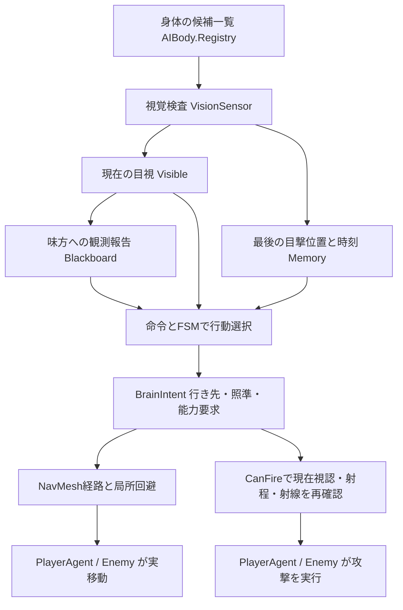

# AIコードの読み方

まずは **`PlayerAgent.Think` → `SquadBrain.Tick` → `VisionSensor.Tick` → `SquadBrain.Decide`** の順で読むと、味方が動くまでの流れを追えます。ファイルはすべて `Assets/Wings/Runtime` にあります。

読みやすさを整えた時点（`d10f88c`）では、コメント・空白・改行だけを変更しました。その後の機能追加である、敵の攻撃枠と進行分散、被弾時の自己防衛、タワー通知、個別指示については [TACTICAL_AI_GUIDE.md](TACTICAL_AI_GUIDE.md) を併せて参照してください。

## 1. 「知る」「決める」「動く」を分ける

| 担当 | 主な場所 | 役割 |
| --- | --- | --- |
| 知る | `AIPerception.cs` / `VisionSensor` | 視界に入った相手と、その最後の観測を記録する |
| 共有する | 同ファイル / `SquadBlackboard` | 味方の観測報告と、包囲位置の担当を期限付きで保持する |
| 決める | `AIBrains.cs` / `SquadBrain`・`EnemyBrain` | 目標、行動状態、行き先、能力の要求を決める |
| 道を探す | `AINavigation.cs` / `PathMotor` | 地形のNavMeshから経路を求め、次に進む方向を返す |
| 身体を避ける | 同ファイル / `CrowdGrid` | 近くの身体から離れる方向を加える |
| 実行する | `PlayerAgent.cs` / `Think`、`Combat.cs` / `Enemy.Update` | 指示に従って身体を動かし、弾や能力を生成する |

`BrainIntent` は判断から実行へ渡す指示書です。`Destination` は目的地、`Direction` は今回進む方向、`Look` は向きたい方向、`Fire` は発砲許可です。`State` と `Reason` は、選んだ行動とその理由を観察するためにも使います。

## 2. 認識：存在していることと、見つけたことは別

ゲーム本体はキャラの現在位置を管理していますが、AIの判断へそのまま全員分を渡すと、壁の裏や背後まで知るAIになってしまいます。

`AIBody.Registry` は、センサーが検査するための実体一覧です。判断に使う敵情報になるには、`VisionSensor.CanSee` で次の条件を通る必要があります。

1. 対象が存在し、生きている。
2. 視認距離内にいる。
3. 正面からの水平角と上下の角度が視野内にある。
4. 目から胴・肩・頭のいずれかへ、遮蔽物に当たらない線が通る。

これはゲーム内の幾何学的な視覚モデルです。カメラ画像から敵を検出する画像認識や、ニューラルネットワークは使いません。タカのULTでは、能力の仕様として4番の遮蔽だけを無視します。

結果は `Contact` に保存します。`Position` は観測した位置、`SeenAt` は観測時刻、`Visible` は直近の検査で見えたか、`Source` は目視・記憶・報告・被弾・タワー通知の出所を示します。被弾とタワー通知は、位置の手がかりを得る追加の入口です。射撃には引き続き直接視認を必要とします。

**壁に隠れた敵が横へ移動する例：** 最後に見た位置をA、隠れた後の位置をBとすると、AIが調べに行くのはAです。記憶の位置をBへ更新することはありません。再び視認できて初めて新しい位置を記録します。

### 見えることと撃てることも分ける

低い壁から頭が出ていれば発見できますが、銃口の前が塞がっていれば撃てません。`CanFire` は、現在の視認、記録した照準位置までの武器射程、銃口からの射線を別途確認します。

センサーは約0.12秒周期で更新しますが、射撃条件は毎フレーム再確認します。`Visible` に残っていても、その後に敵が隠れれば発砲は許可されません。

## 3. 記憶と報告：古さを残したまま使う

直接見失った観測は、位置を固定したまま短期記憶になります。標準設定では3秒で失効し、`Confidence` は経過時間とともに1から0へ下がります。この値は情報の鮮度の目安であり、統計的な正解確率ではありません。

味方の報告はブラックボードへ保存します。ブラックボードとは、複数のAIが参照できる共有メモです。報告には相手のTransformを入れず、位置と元の観測時刻を渡します。標準の有効期間は1.5秒です。

報告を受け取った時刻で期限を数え直すと、伝言を繰り返すだけで古い情報が新しくなってしまいます。そのため、直接の目視だけを `Publish` できるようにし、元の観測時刻を維持しています。

味方は最新の自己記憶と最新の他者報告を比較します。報告の信頼度は最大0.65から減衰し、0.2以上の手がかりを捜索に利用します。**手がかりは行き先に使い、攻撃用の `Target` には設定しません。** 自分で再発見するまで撃たない、という境界です。

## 4. 行動選択：FSMと優先順位付きルール

FSM（有限状態機械）は、「今は何をしているか」を有限個の状態で表し、条件によって切り替える方法です。本作では `Guard`（警戒）、`Regroup`（合流）、`Attack`（攻撃）、`Investigate`（捜索）などを使います。

プレイヤーが指定する `Follow`・`Defend`・`Assault` は大命令です。同じ防衛命令でも、離れすぎれば合流、射線が悪ければ位置調整、撃てれば攻撃、というように下位のFSM状態が変わります。

`SquadBrain.Decide` は通常、次の優先順位で指示を作ります。実際に被弾した直後の3秒間は、最後に `ApplySelfDefense` が自己防衛を優先させます。

1. 追従・防衛の許可範囲を超えたら、帰還を優先する。
2. 目視した敵がいれば、射線と適正距離に応じて位置調整・接近・攻撃を選ぶ。
3. 敵が見えず有効な記憶や報告があれば、その地点を調べる。
4. 手がかりがなければ、攻撃命令では巡回、他の命令では編隊や警戒位置へ向かう。

これは条件の優先順位で選ぶルールベースと、行動状態を表すFSMの組合せです。GOAPのように行動列を探索して計画する処理はありません。`Down` は状態の定義にはありますが、実際のダウンと復帰は `PlayerAgent` 側で管理しています。

## 5. 目標選択：ユーティリティ評価と揺れの抑制

複数の敵が見えている場合は、`ChooseTarget` で候補を点数化します。これが本作でのユーティリティベースAIの使用箇所です。行動全体を点数化しているわけではありません。

`点数 = 45 − 適正距離との差 + タワーへの接近度 × 25 − 他の担当数 × 8`

- 得意な距離に近い相手を選びやすくする。
- タワーに迫っている相手を優先しやすくする。
- 既に味方が担当している相手への集中を減らす。

少し点数が変わるたびに目標を切り替えると、照準や移動が落ち着きません。そこで標準0.65秒の保持時間と、切替に必要な8点の差を設けます。こうした切替の余裕をヒステリシスと呼びます。ただし現在目標を見失った場合は、その相手を維持する分岐には入りません。

能力選択の `PlanAbilities` は別のルールです。目標周辺や自分の近くに**見えている**敵の数、強化弾やゲージの残量で使用要求を出します。使用可能かの最終確認とクールダウン処理は `PlayerAgent` が担当します。

## 6. 協調と移動：予約・経路・局所回避

`ReserveSlot` は、目標の周囲の位置を担当として予約します。全員が同じ座標へ進む代わりに、通常は8方向、タワーは12方向の位置を使います。予約は標準0.8秒で失効し、同じ担当を継続している間は期限だけ更新します。空きがなければ重複もあり、狭い場所で列になることを完全に防ぐ仕組みではありません。

`NavigationWorld` は地形のColliderから歩ける領域であるNavMeshを生成します。`PathMotor` はUnityの経路計算を使って折れ点を取得し、近付いた点から順に通過します。NavMeshAgentで身体を動かす方式ではなく、計算した方向を既存のCharacterControllerへ渡しています。

その方向へ、`Arena.Steer` の近距離の壁回避と、`CrowdGrid.Steer` の身体同士の分離を組み合わせます。`CrowdGrid` は平面をセルに分け、周囲3×3セルだけを調べる空間分割です。この近傍情報を戦闘の発見情報へ変換することはありません。

地図・タワー位置・味方のリーダー位置は、任務や通信から既知の情報として扱います。未発見の敵の現在位置とは区別します。

## 7. 敵AIも同じ認識の制約を守る

`EnemyBrain` は、既知のタワーへ向かうのが基本です。センサーで発見した相手だけを距離とデコイ優先度で比較し、条件に合えば交戦します。見失えば最後の目撃地点を最大2秒ほど調べ、その後はタワーへの任務に戻ります。

弾の命中やカラスULTの全敵効果で `Enemy.All` を列挙する箇所は、攻撃効果を実体へ適用する処理です。その列挙結果を認識情報へ戻す処理はありません。

## 8. 動かしながら読む

戦闘中の **F1** で、操作キャラの次の編成番号にいる味方の状態・理由・直接目視数・射撃許可・記憶を確認できます。Unityでは `AIBody` を選択しGizmosを有効にすると、視野と観測地点を確認できます。

最初は「敵を背後に置く」「壁に隠す」「追従中に操作キャラだけ離れる」を試し、表示された状態と該当分岐を対応させると読みやすくなります。

調整値は `Assets/Wings/Resources/WingsAI.asset`、詳細な仕様は [AI_REFINEMENT.md](AI_REFINEMENT.md)、認識を意図どおり制限できているかの自動確認は `AIVerification.cs` を参照してください。
