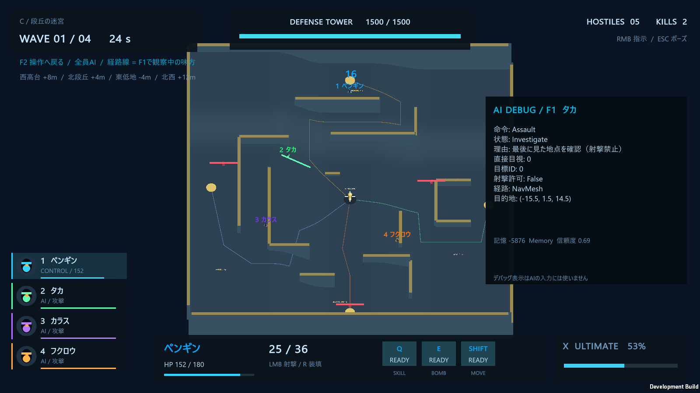
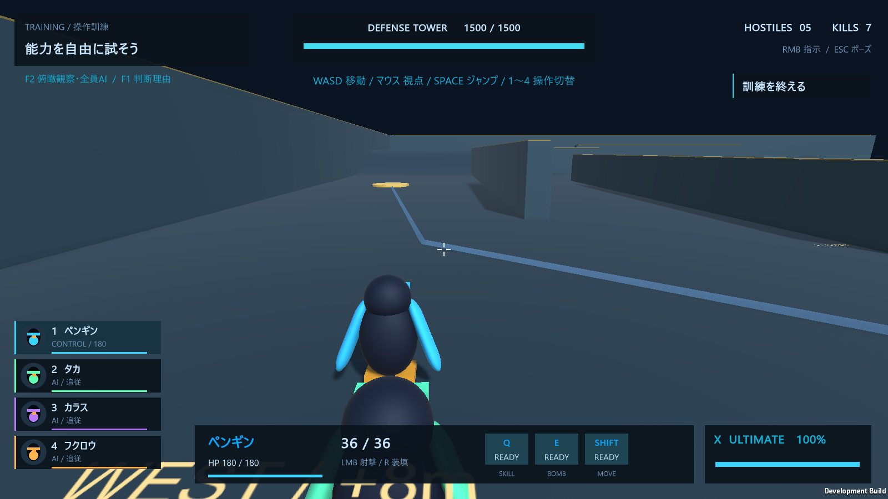

# mapC / 段丘の迷宮

ステージ選択の **C / 段丘の迷宮** から出撃します。5羽から4羽を編成する操作はA/Bと共通です。

## 地形と観察ポイント

床は128m四方で、A/Bの64m四方から面積が約4倍になっています。中央のタワーを基準に、西は8mの高台、北は4mの段丘、東は4m低い盆地、北西は12mの高台です。最大の高低差は16mです。斜面は徒歩で上り下りできる勾配です。

| 区域 | 地形 | 観察しやすいAIの挙動 |
| --- | --- | --- |
| 西 | 高台・向きの違う長い壁・南北の迂回路 | 遮蔽で見失う、最後の目撃地点を調べる、角を回って再発見する |
| 北 | 段丘・坂・交互に張り出す壁 | 直進できない経路の選択、坂を含む経路の折れ点への追従 |
| 東 | 低地・コの字の囲い・複数の回り道 | 見えることと撃てることの区別、行き止まりからの迂回 |
| 南 | 廃墟の広場・曲がった路地 | 編隊のまとまり、狭い通路の隊列、開けた場所での分離 |

壁と床は実際のColliderを持ちます。高さは見た目だけではなく、身体の配置・歩行・視覚・弾・範囲効果へ反映されます。床上の色付き線は地形の案内であり、AIに強制する固定ルートではありません。

## F2で俯瞰観察

- **F2**: 俯瞰カメラへ切替。操作キャラもAIへ任せ、4羽全員の行動を観察します。再度F2で操作へ戻ります。
- **F1**: 味方AIの状態・判断理由・直接目視数・射撃許可・記憶を表示します。
- **1〜4**: 操作対象を切り替えます。F1の観察対象はその次の編成番号です。
- **右クリック長押し＋左クリック**: 追従・防衛・攻撃の命令を切り替えます。

俯瞰中のキャラ名は位置の確認用、キャラ色の線はF1で観察している味方の計算済みNavMesh経路です。全体を見渡せるカメラと、各AIが認識している情報は別です。カメラに敵が映っただけでAIに敵情報を追加することはありません。俯瞰へ切り替えても戦闘は進みます。

防衛命令でタワー付近の戦闘を観察した後、攻撃命令にして見失った相手の捜索や巡回を確認できます。追従命令では、俯瞰の全員AI中は選択中のキャラも自律移動します。操作へ戻ってリーダーを高台へ動かすと、味方の合流経路を確認しやすくなります。

## 実装の要点

`ArenaMapC.cs` が高さ場のメッシュと遮蔽物を生成します。`Arena.Ground` はCではそのメッシュと同じ三角形補間で床の高さを返し、A/Bでは従来の高さ0を維持します。地面の上にある壁の天面を、歩行面として拾う方法は使っていません。

| レイヤー | 用途 |
| --- | --- |
| 8 / Wall | 壁、建物、氷壁。視界・弾・近距離の壁回避を遮る |
| 9 / Wings | 味方キャラクターの身体 |
| 10 / Terrain | Cの歩ける床。視界・弾を遮るが、坂を壁として回避させない |

NavMeshは床と壁を両方収集します。視覚センサーには設定の遮蔽物に加えてTerrainも含め、尾根の向こうが見える状態を防ぎます。`Arena.Steer` の水平な壁回避ではTerrainを含めず、坂を上る方向を妨害しないようにしています。CharacterControllerが斜面を上り、重力が下り坂でも足を床へ戻します。

`MapCObservation.cs` は表示と観察モード、`MapCVerification.cs` は検証です。一般的なAIの読む順序は [AI_CODE_GUIDE.md](AI_CODE_GUIDE.md) を参照してください。

## ビルド・検証

Unityの **WINGS > Build Map C** で `Builds/MapC/WINGS_REVOLT_MapC.exe` を作ります。A/Bもこの実行版に含まれます。

`--wings-mapc-test --wings-report <出力先>` で、床の高さと物理形状の一致、全入口からの完全経路、地形の遮蔽、味方の実際の上り、敵の実際の下り、俯瞰の切替、4ウェーブの自然な終了を確認します。保存結果と画面は `Docs/MapC_Verification` を参照してください。

従来の認識・協調検証は `--wings-ai-test`、5羽の能力・画面遷移の回帰確認は `--wings-smoke` を引き続き使用できます。いずれも通常プレイの最高記録は更新しません。

## 確認画像

