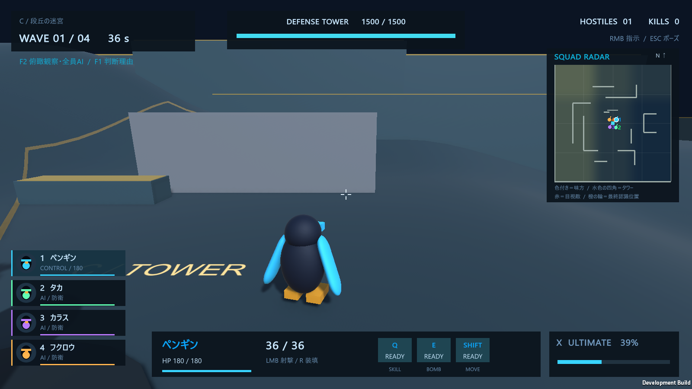
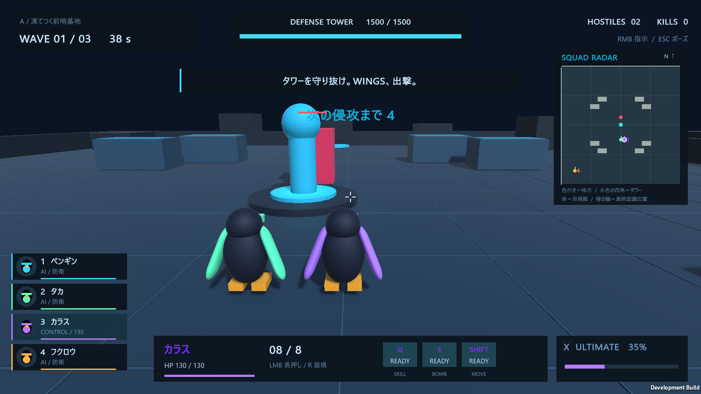
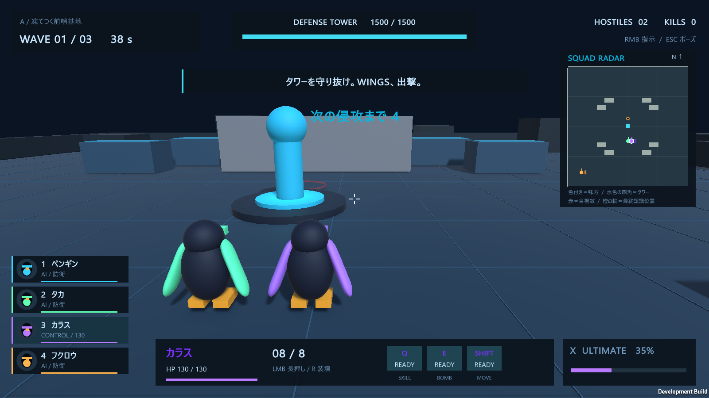

# ミニマップと敵を貫通する通常攻撃

## ミニマップ

戦闘画面の右上に常時表示します。A/B/Cと訓練に対応し、北（+Z）を上、東（+X）を右に固定します。mapCでは高い床ほど明るく、低地ほど青い色になります。壁は灰色で表示し、一時的な氷壁の出現・消滅も反映します。

| 表示 | 意味 |
| --- | --- |
| キャラ色の点・番号・短い方向線 | 味方の位置、編成番号、向き。操作中の味方には白い縁を付ける |
| 水色の四角 | タワー |
| 赤い点 | 生存中の味方の誰かが目視している敵 |
| 橙の輪 | 見失った敵や、被弾・タワー通知で得た最終認識位置。古くなると薄くなり、記憶期限で消える |

敵の表示は、全味方の `VisionSensor.Known` に入っている認識記録を統合して作ります。同じ敵を複数の味方が見ても1つだけ表示し、目視情報を優先、同条件なら新しい観測を採用します。操作キャラを切り替えても、他の味方が知っている情報は残ります。

**未発見の敵は表示しません。** 見失った敵は記録済みの座標に輪を残し、現在のTransformから位置を読み直しません。地図を描くために視覚走査を実行することもありません。俯瞰カメラに映っているだけの敵は、味方が認識していなければミニマップには出ません。

地形と味方位置は既知の任務・通信情報として扱います。地形表示用の収集は壁のColliderだけを対象にし、敵が映り込むカメラ画像は使用しません。認識情報の統合は約0.1秒、壁の再収集は約0.25秒ごとです。

F1のAI説明パネルは左側へ移動しました。個別命令画面とポーズ画面は、ミニマップより手前に表示します。訓練の終了ボタンはミニマップの下にあります。

## 敵の貫通と壁の貫通

| 攻撃 | 敵の身体 | 壁・地形 |
| --- | --- | --- |
| タカの通常射撃 | 射線上の複数の敵を貫通 | 止まる |
| タカのULT中の射撃 | 射線上の複数の敵を貫通 | 既存の能力どおり貫通 |
| カラスのフルチャージ射撃 | 複数の敵を貫通。各敵へ直接命中は1回 | 止まる |
| カラスのチャージ途中の射撃 | 最初の敵で止まる | 止まる |

カラスの「次の5射をフルチャージ扱い」にするスキルも敵を貫通します。爆発強化との併用時は、貫通した各着弾点で爆発します。タカの距離による威力上昇、カラスの即死抽選・ボスへの追加ダメージ、弾数や強化回数の消費は維持しています。

## 実装を読む・調整する

- `Assets/Wings/Runtime/MinimapUI.cs`：地形の色、表示枠 `MinimapMapRect`、更新間隔、記憶と目視の統合、マーカー描画。
- `Assets/Wings/Runtime/WingsUI.cs`：HUDと各画面の描画順。
- `Assets/Wings/Runtime/AIDebugUI.cs`：AI説明パネルの位置と文字サイズ。
- `Assets/Wings/Runtime/PlayerAgent.cs`：`Fire` のカラスのフルチャージ指定、`BeamAttack` のビーム命中処理。
- `Assets/Wings/Runtime/Combat.cs`：`Projectile.Update`。壁の検査と敵の貫通を分け、命中済みの敵を記録する。

記憶の有効時間は、従来どおり `Assets/Wings/Resources/WingsAI.asset` の `Memory Seconds` で調整できます。

## ビルド・確認

Unityの **WINGS > Build Tactics** で `Builds/Tactics/WINGS_REVOLT_Tactics.exe` を更新します。

`--wings-minimap-test --wings-report <出力先>` で、認識情報の扱い、実際の複数命中・壁での停止、スキルとボムの併用、A/B/Cの画面、終了時の情報破棄を確認します。[新機能の検証レポート](Minimap_Verification/minimap-report.json) と画像を保存しています。

既存機能の確認は `--wings-smoke`、`--wings-ai-test`、`--wings-tactics-test`、`--wings-mapc-test` を引き続き使用できます。

2026-10-22の最終ビルドでは、新機能26項目、既存機能48項目、認識・協調AI33項目、戦術AI28項目、mapC17項目の計152項目がすべて通りました。5つの検証プロセスは終了コード0で完了し、A/B/Cの任務も自然に勝利へ到達しています。

今回の実行版での回帰確認結果は [既存機能](Minimap_Regression/report.json)、[認識・協調AI](Minimap_Regression/ai-report.json)、[戦術AI](Minimap_Regression/tactics-report.json)、[mapC](Minimap_Regression/mapc-report.json) に保存しています。これらの `checks` には、検証項目に加えて6件の任務結果記録が含まれます。

