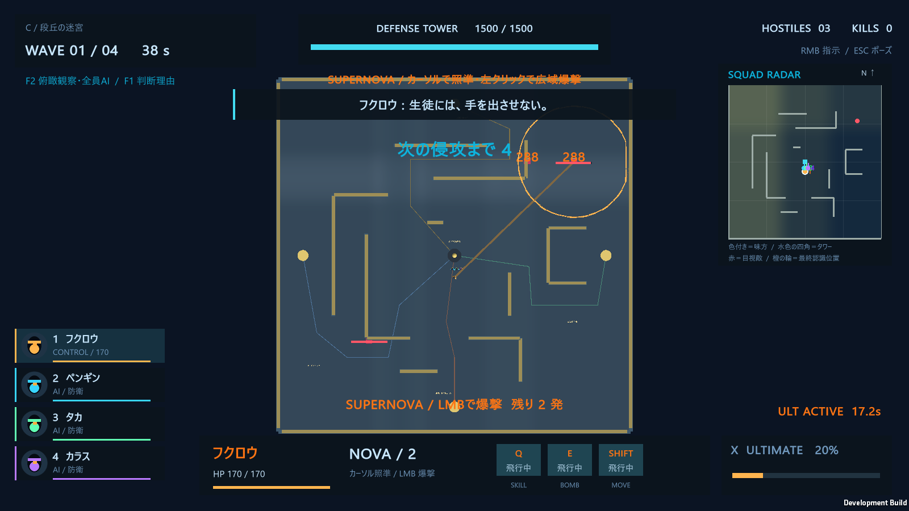
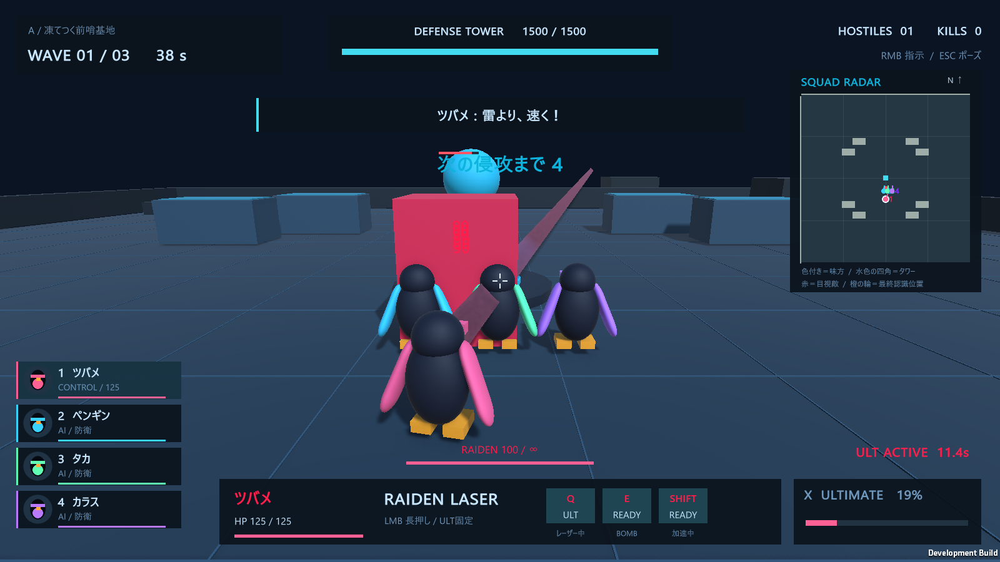

# フクロウの高空爆撃・ツバメのリワーク

## フクロウ：スーパーノヴァ

Xで発動すると、身体そのものが高空へ上昇し、カメラがステージ全体を見渡す上面視点へ引きます。A/Bでは地面から約80m、広いmapCでは約115mが標準高度です。上昇は約0.6秒です。

カーソルで地点を狙い、左クリックで爆撃します。照準位置には爆発範囲の円を表示します。従来の22mの能力照準制限は使わず、ステージ内の遠い地点も狙えます。爆撃の半径は **8mから20m** に拡大しました。基礎威力240と、複数の敵を巻き込むほど威力が上がる性質は維持しています。

- 爆撃は3発。通常弾倉・装填とは独立しています。
- 上昇完了後に爆撃でき、3発を撃ち切るか18秒が経過すると降下します。
- 飛行中はその場に留まり、被弾を無効にします。通常スキル・ボム・ムーブは着地後に使えます。
- 操作キャラを切り替えると通常カメラへ戻り、飛行中のフクロウを操作すると高空カメラへ戻ります。
- AIも直接視認した相手を爆撃します。目は実際の身体と一緒に上昇し、爆撃中だけ真下を基準とする視野へ切り替わります。距離と遮蔽の検査は残り、固い屋根の下の敵などを無条件には発見しません。

着地時には通常の視認距離と視野角へ戻し、空中で確保していた行動状態も解除します。地上のキャラが高空のフクロウの真下を身体回避のために避け続けることもありません。

## ツバメ：通常射撃

| 項目 | 変更前 | 変更後 |
| --- | --- | --- |
| 射撃間隔 | 0.48秒 | **0.18秒** |
| 装弾数 | 12発 | **30発** |
| 1回の射撃 | 光弾7個、弾倉を1発消費 | 同じ |
| 光弾1個の基礎威力 | 12 | 同じ |

光弾はそれぞれ独立した命中判定を持ちます。同じ一斉射の複数の光弾が同じ敵へ当たっても、それぞれダメージを与えます。一度当たった同じ光弾が、その敵へ毎フレーム重複してダメージを与えることはありません。近距離でまとめて命中させると高い威力を出せます。

## ツバメ：Qのレーザーモード

**Qでレーザーモードへ切り替え、射撃ボタンを長押しするとレーザーを放ち続けます。** Qを押しただけでは射撃せず、ゲージも消費しません。Qをもう一度押すと通常射撃へ戻ります。従来の「40ゲージを消費して1回発射するスキル」は、この切替方式に置き換えました。

| 項目 | 通常時 | ULT中 |
| --- | --- | --- |
| レーザーの毎秒ダメージ | 600 | 900 |
| 射程 | 34m | 55m |
| 命中判定の周期 | 0.1秒 | 0.1秒 |
| レーザー射撃中の消費 | 毎秒30ゲージ | 消費なし |

レーザーは旧スキルの敵・壁貫通を維持します。各判定周期で射線上の相手へ一度ずつ、その周期分のダメージを与えます。弾倉を使わないため、通常弾が空だったり装填中だったりしても、ゲージがあればレーザーを撃てます。

Shiftの加速とレーザーは併用できます。加速は毎秒22ゲージ、両方を使っている間は合計で毎秒52ゲージを消費します。ゲージが0になると両方を解除し、通常の射撃・移動へ戻ります。射撃も加速もしていなければ毎秒14ゲージ回復します。レーザーモードを選択したままでも、射撃を止めて回復できます。

ULTは12秒間、レーザーモードを常時有効にし、加速も開始します。**ULT中もレーザーの射撃には左ボタン長押しが必要です。** Qで通常射撃へ戻すことはできず、加速と射撃を同時に使ってもゲージは100を維持します。ULT終了後は、その前にQで選択していた武器モードへ戻ります。加速はShiftで解除するか、通常のゲージ消費で残量が0になるまで継続できます。

味方AIは、目視した相手の距離と集まり方で通常射撃／レーザーを選びます。レーザーの開始は45以上、残量が12未満になったら解除する基準を設け、Qを判断のたびに反転させる動きを防いでいます。未発見の相手へレーザーを向けることはありません。

## 調整場所

UnityのProject欄で **`Assets/Wings/Resources/WingsAbilities.asset`** を選び、Inspectorで変更します。

| 設定名 | 内容 |
| --- | --- |
| Nova Radius / Damage / Duration | 爆撃半径・基礎威力・爆撃モードの制限時間 |
| Minimum Flight Height / Flight Extent Multiplier | 最低高度・ステージサイズに応じた高度の倍率 |
| Ascent Seconds / Descent Seconds | 上昇・降下にかける時間 |
| Laser Damage Per Second / Empowered Laser Damage Per Second | 通常／ULT中のレーザー威力 |
| Laser Tick Interval | レーザーの命中判定周期。毎秒威力はこの周期に応じて分配する |
| Laser Range / Empowered Laser Range | 通常／ULT中の射程 |
| Laser Width / Empowered Laser Width | 通常／ULT中の命中幅 |
| Laser Drain Per Second / Acceleration Drain Per Second | レーザー／加速のゲージ消費速度 |
| Raiden Recovery Per Second | ゲージ回復速度 |

通常射撃の間隔・装弾数・威力は **`Assets/Wings/Resources/Characters/Swallow.asset`** の `Fire Interval`・`Magazine`・`Damage` です。`Magazine=0` のキャラは、従来のキャラ別装弾数を使います。

## コードの読み方・検証

- `CharacterAbilities.cs`：レーザーの切替、継続射撃、ゲージ合算、身体の上昇・降下。
- `PlayerAgent.cs`：手動操作／AIから同じ能力へ接続。弾倉とゲージ武器の発射条件を分ける。
- `OwlBombardmentView.cs`：爆撃カメラ、カーソル、照準範囲の表示。
- `AIBrains.cs`／`AIPerception.cs`：高空からの認識と爆撃判断、ツバメのモード選択。
- `AbilityTuning.cs`：上記の設定アセットの定義。

Unityの **WINGS > Build Tactics** で `Builds/Tactics/WINGS_REVOLT_Tactics.exe` を更新できます。`--wings-rework-test --wings-report <出力先>` は、仮想マウス・キーボードを使って実際の長押し・Q入力・爆撃照準を通し、身体の上昇、遮蔽、着地、AIによる使用まで確認します。

[新機能の確認結果](Rework_Verification/rework-report.json) と、[既存機能](Rework_Regression/report.json)、[認識・協調AI](Rework_Regression/ai-report.json)、[戦術AI](Rework_Regression/tactics-report.json)、[mapC](Rework_Regression/mapc-report.json)、[ミニマップ・貫通射撃](Rework_Regression/minimap-report.json) の結果を保存しています。

2026-10-22の最終版では、新機能46項目・既存機能48項目・認識協調AI33項目・戦術AI28項目・mapC17項目・ミニマップと貫通射撃26項目の、計198項目が通りました。6つの検証プロセスはすべて終了コード0で完了しています。レポートの `checks` には、これらに加えて7件の任務結果記録が含まれます。

