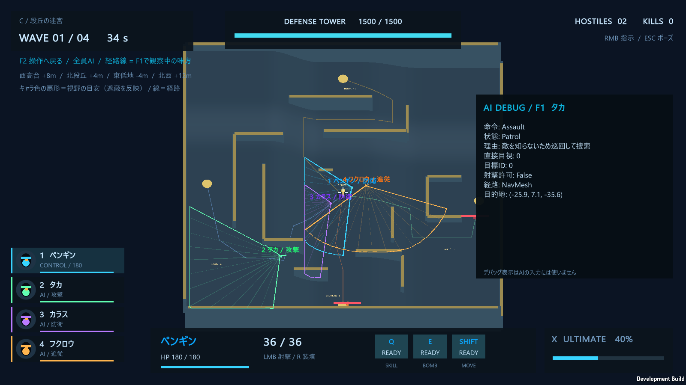
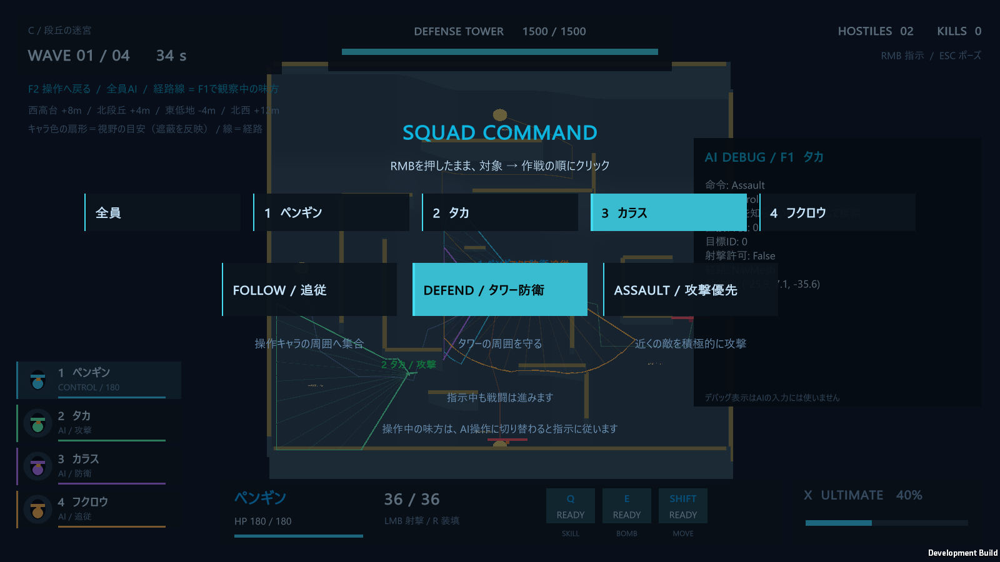

# 敵の協調・自己防衛・個別指示

## 操作して確認する

mapCで **F2** を押すと、4羽全員をAIへ任せて俯瞰できます。各キャラの色の扇形が視野の目安、キャラ名の横が現在の作戦です。**F1** では味方の状態・判断理由・射撃許可を確認できます。

**右クリックを押したまま、対象（全員／各キャラクター）→ 作戦の順に左クリック**すると指示を出せます。追従・タワー防衛・攻撃優先を1羽ずつ指定できます。「全員」への指示は個別指示を置き換えます。操作中のキャラへの指示も保持し、AIへ切り替えたときに使います。命令画面を開いている間も戦闘は進みます。

## 敵が仲間の状態を考えて進む

`EnemyCoordination.TransitWaypoint` はNavMeshの次の折れ点へ向かう途中に、横方向へ5つの進行候補を作ります。近傍9m以内の、遮蔽されていない同陣営の敵の移動方向と状態から、約0.5秒後の位置を予測します。

候補の評価では、仲間との間隔、攻撃中・凍結中の仲間、射手の正面を塞ぐ位置を避けます。個体ごとに好む横位置をずらし、左右へ分散させます。NavMesh上で直接通れる候補だけを採用し、約0.55秒保持して細かい左右の揺れを抑えます。近傍検索は既存の空間分割を共用します。

これは局所的な予測と候補の点数比較です。狭い通路では通れる幅を優先するため、一時的に列になることはあります。戦闘相手の情報は視覚センサーから取り、仲間の協調情報から未発見のプレイヤーを知ることはありません。

## 1キャラクターにつき攻撃中の敵は4体まで

`EnemyCoordination` が、プレイヤーキャラクターごとの期限付き攻撃枠を管理します。`EnemyBrain` は目視・射程・射線に加え、枠を取れた場合だけ `Attack` 状態と発砲を許可します。各プレイヤーは独立した4枠を持ちます。

枠が埋まっていれば、別の目視済みの相手を検討し、選べなければ `Support` として側面へ移動します。凍結・ノックバック・撃破・射撃条件の喪失で枠を返します。更新されない予約は0.45秒で失効し、古い `Attack` 状態も解除してから次の敵へ渡します。毎フレームの更新では予約を再利用します。

タワーとデコイへの攻撃は、このプレイヤー別上限の対象外です。発射済みの弾は枠を返した後も飛び続けます。

## 被弾した味方の自己防衛

実際にダメージを受けると、`PlayerAgent.Hit` から `SquadBrain.OnAttacked` を呼びます。最後の被弾から3秒間は、追従・防衛・攻撃の作戦範囲より自己防衛を優先します。退避候補はNavMesh上で通れる方向から選び、被弾が止まれば元の個別作戦へ戻ります。

| 状態 | 行動 |
| --- | --- |
| 攻撃者が現在見える | `Kite`。相手を向き、距離を取りながら射撃する |
| 振り返れば見える条件を満たすが、背後にいる | `React`。被弾時の位置を記録し、退避しながら振り返る。再視認まで射撃しない |
| 距離・上下角・遮蔽の条件を満たさない | 攻撃者を特定せず回避する。隠れた攻撃者の位置を得ない |

被弾認識では水平視野角だけを例外とし、視認距離・上下角・胴／肩／頭への遮蔽条件を維持します。タカの壁越し視認能力中は、その能力の遮蔽例外が適用されます。人が操作中のキャラはAIに操作を強制されません。

## 認識情報の出所と記憶

`EvidenceSource.Damage` と `TowerAlert` を追加し、目視とイベントで得た情報を区別しました。

| 入り口 | 得られる情報 | その後 |
| --- | --- | --- |
| 被弾 | 上の認識条件を通った攻撃者の、被弾した瞬間の位置 | 座標と時刻を固定。移動しても自動更新しない |
| タワーが実際にダメージを受ける | 生存している全味方へ、攻撃者のその瞬間の位置を通知 | 距離・方向を問わず記憶できる。相手の現在位置を継続受信しない |

イベント情報は `Visible=false` の記憶です。通常の記憶期限と鮮度の減衰を使い、命令範囲内での捜索の手がかりにします。受信しただけでは発砲を許可せず、自分で再視認し、射程と銃口の射線も確認します。イベント記憶を、新鮮な目撃情報として味方へ再配信することもありません。

## 視野表示の読み方

`ObservationVision.cs` は、各味方の水平視野角・視認距離を使って輪郭を描き、目の高さから壁・地形へ飛ばしたレイで切り詰めます。描画は約0.12秒ごとに形を更新します。

**扇形は水平投影の目安です。** 実際の発見判定には上下角と相手の身体3点も使うため、段差や低い壁では輪郭と判定が完全には一致しません。表示処理はセンサーの走査・発見・記憶を更新しません。俯瞰カメラに見える敵と、AIが知る敵は別です。

## コードを読む順序

1. `SquadCommands.cs`：全体指示と個別指示の解決。
2. `AIBrains.cs`：`OnAttacked` → `ApplySelfDefense` → `Tick`、敵は `EnemyBrain.Decide` → `Tick`。
3. `AIPerception.cs`：`CanSee`、`RememberEvent`、`CanFire`。認識と射撃許可の境界。
4. `EnemyCoordination.cs`：攻撃枠と進行候補の評価。`AINavigation.cs` が移動へ接続。
5. `Combat.cs`／`WingsGame.TowerHit`：実際の攻撃イベントの伝達。
6. `ObservationVision.cs`／`WingsUI.OrdersUI`：観察と指示の画面。

技術としては、FSM、優先順位付きルール、候補の効用評価、期限付きの共有予約、NavMesh、局所回避、イベントに基づく認識を組み合わせています。機械学習やGOAPは使用していません。

## ビルドと検証

Unityの **WINGS > Build Tactics** から、A/B/Cを含む `Builds/Tactics/WINGS_REVOLT_Tactics.exe` を作成します。

| 引数 | 確認内容 | 保存結果 |
| --- | --- | --- |
| `--wings-tactics-test` | 攻撃上限、枠の返却、隊列の分散、被弾認識と実際の引き撃ち、タワー通知、個別指示、4人分の描画、mapCの自然な終了 | [Tactics_Verification](Tactics_Verification/tactics-report.json) |
| `--wings-ai-test` | 既存の認識・記憶・報告・命令範囲・協調、A/Bの終了 | [Tactics_AI_Regression](Tactics_AI_Regression/ai-report.json) |
| `--wings-smoke` | 5羽の能力と既存の画面・プレイの回帰確認 | [Tactics_Gameplay_Regression](Tactics_Gameplay_Regression/report.json) |
| `--wings-mapc-test` | mapCの地形、経路、遮蔽、実移動、観察切替、任務終了 | [Tactics_MapC_Regression](Tactics_MapC_Regression/mapc-report.json) |

各引数に `--wings-report <出力先>` を追加できます。検証プレイでは通常の最高記録を更新しません。

2026-10-22の最終ビルドでは、新機能28項目・既存AI33項目・既存機能48項目・mapC17項目の計126項目が通りました。全4検証プロセスは終了コード0で完了し、A/B/Cの任務は自然に勝利へ到達しています。レポートの `checks` には、この126項目に加えて6件の任務結果記録が入っています。

